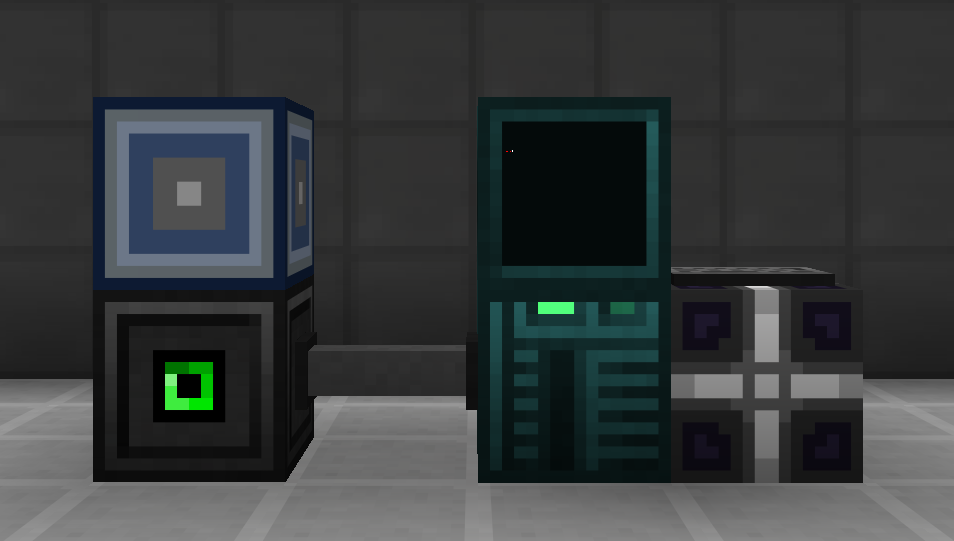
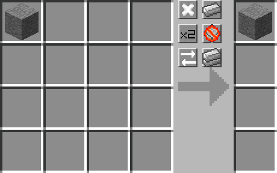

# Introduction
These OpenComputers (OC) scripts automatically pattern recipes in large batches with a single command. The inputs/outputs of each recipe are stored as code which can be quickly referenced at any time and updated as necessary; they do not need to be stored in a subnetwork or database address. Autopatterning is perfect for making many recipes at once and for recipes that are not easily translatable from NEI (e.g. NAC or BEC recipes). The only player intervention is providing dummy patterns to an ME dual interface and then distributing the final patterns to wherever they are needed.

# Bare Minimum Components
The following requires access to EV circuits and epoxid (mid-late HV). It is possible to save some resources by not including the internet card, but that would require manually copying and pasting the code from GitHub which is NOT recommended for multiple reasons. Do not mix up central processing unit (CPU) with accelerated processing unit (APU).

- Tier 2 Computer Case
- Tier 2 Memory
- Tier 1 Accelerated Processing Unit
- Tier 1 Hard Disk Drive
- Tier 1 Screen
- Internet Card
- Keyboard
- Adapter
- EEPROM (Lua BIOS) [1]
- OpenOS Floppy Disk [2]

[1]  A regular EEPROM without Lua BIOS does not work.
[2]  Any other type of floppy disk does not work. The OpenOS one is green and says OpenOS in its tooltip.

# Building the Setup

1) Place the computer case, screen, keyboard, and adapter in any sort of orientation as long as they can all connect to each other.
2) Place a full-block ME dual interface next to the adapter. The interface does not have to be powered or part of an AE2 network.
3) Insert the bare minimum components into the computer case. Power the computer with an AE2 cable, neutronium energy cell, or power converter.
5) Turn the computer on and follow the commands on screen 'install' --> 'Y' --> 'Y'. The OpenOS floppy disk is no longer needed in the computer afterwards.
6) Install the required scripts by copying this line of code into the computer (middle-click to paste).

       wget https://raw.githubusercontent.com/DylanTaylor1/GTNH-AutoPattern/main/setup.lua && setup

7) Prepare a stockpile of dummy patterns and insert them into the ME dual interface before running the script.

# Dummy Patterns
Dummy patterns are necessary because blank patterns cannot be edited or even inserted into an ME dual interface. Dummy patterns in this case are just like normal patterns except they have a SINGLE random input and a SINGLE random output (e.g. 1 stone makes 1 stone). The exact items are irrelevant since the data is overwritten anyway. Encode dummy patterns in an ME pattern terminal and make an entire stack at once by holding SHIFT+CTRL.

 &nbsp; &nbsp; &nbsp; &nbsp; 

Automation methods cannot insert the dummy patterns into the proper slots of an ME dual interface so they need to be inserted manually, but that is a single shift-click for up to 36 at once. The script always begins with the first slot in the interface (bottom-left) and moves in order to the last slot (top-right). If it cannot find a dummy pattern in the next slot, then it stops immediately and prints an error message to the screen.

# Running the Scripts
The main script is "pattern" and it works by pulling the data from one of the many different recipe files or batches stored locally on the computer. Run the script by entering the following command where \<key\> refers to one of the recipe filenames (e.g. NAC_circuits). After some basic input validation, it immediately starts overwriting the dummy patterns in the ME dual interface until everything in that file or batch is successfully patterned. Renamed items must be added manually afterwards in a pattern terminal, if applicable.

       pattern <key>

The helper script "scan" works in reverse of the main script. It extracts all the pattern data from the ME dual interface, parses it into the proper format, and then outputs everything into a separate file called results.txt. Scan is not necessary and likely never needs to be used by the average player, but it can help build the recipe files for the main script.

       scan

The last script "uninstall" removes everything in this repo from the computer.

       uninstall
